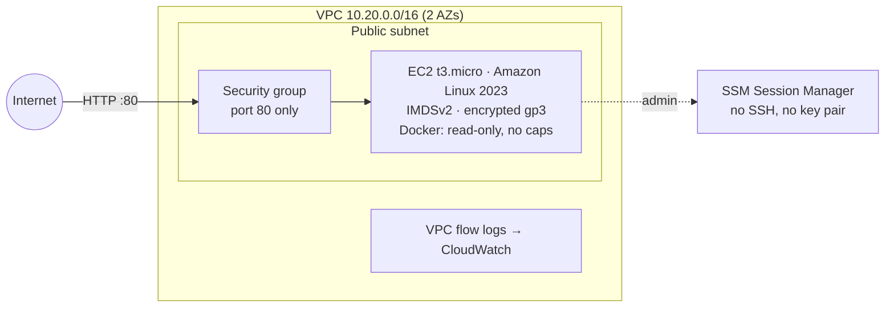

# Terraform on AWS: a hardened containerised web app

[](https://github.com/iyedboubakri12/terraform-aws-webapp/actions/workflows/terraform.yml)

Infrastructure as Code for a small, secure-by-default web stack on AWS, written as **reusable Terraform modules** with a CI that runs `fmt`, `validate`, **TFLint** (AWS ruleset) and a **Trivy** misconfiguration scan on every push, and a `plan` job that authenticates to AWS through **GitHub OIDC** (no stored access keys).



## What is in it

| Module | Resources | Security decisions |
|---|---|---|
| `modules/network` | VPC, 2 public subnets across AZs, IGW, route table, VPC flow logs + IAM role | default security group emptied, no auto-assigned public IPs, flow logs of rejected traffic |
| `modules/web` | EC2 instance, security group (separate rule resources), IAM role + instance profile | **no SSH port, no key pair** (SSM Session Manager), **IMDSv2 required**, encrypted root volume, container run read-only with all capabilities dropped |
| `envs/dev` | composes the two modules, default tags | provider pinned (`~> 6.0`), lock file committed, S3 backend example with native locking |

The AMI is resolved from AWS's public SSM parameter, so no AMI ID is hard-coded.

## CI

| Job | What runs |
|---|---|
| `static-checks` | `terraform fmt -check`, `init -backend=false` + `validate` on every root and module, `tflint --recursive` with the AWS ruleset, `trivy config` failing on HIGH/CRITICAL |
| `plan` | only if the repository variable `AWS_ROLE_ARN` is set: assumes that role via OIDC and runs `terraform plan` |

Accepted Trivy findings are listed in [`.trivyignore`](.trivyignore), each with its reason (public port 80 for a demo, egress for package pulls).

## Deploy it (≈ free tier, destroy afterwards)

```bash
cd envs/dev
terraform init
terraform plan  -var 'allowed_http_cidrs=["<your-ip>/32"]'
terraform apply -var 'allowed_http_cidrs=["<your-ip>/32"]'
terraform output url          # open after 1–2 minutes of boot
aws ssm start-session --target "$(terraform output -raw instance_id)"
terraform destroy
```

To run the API from my [DevSecOps pipeline repo](https://github.com/iyedboubakri12/devsecops-github-actions-pipeline) instead of NGINX, make its GHCR package public and pass
`-var 'container_image=ghcr.io/iyedboubakri12/inventory-api:<sha>'`.

Costs: `t3.micro` and 8 GB gp3 are free-tier eligible in most regions; flow logs only keep rejected traffic for 7 days. Public IPv4 addresses are billed by AWS, so destroy the stack when you are done.

## Next steps

- Move the instance to a private subnet behind an ALB with HTTPS (ACM).
- Replace the single instance with an Auto Scaling group and a launch template.
- Remote state in S3 by default (see `envs/dev/backend.tf.example`) and a `prod` environment.
